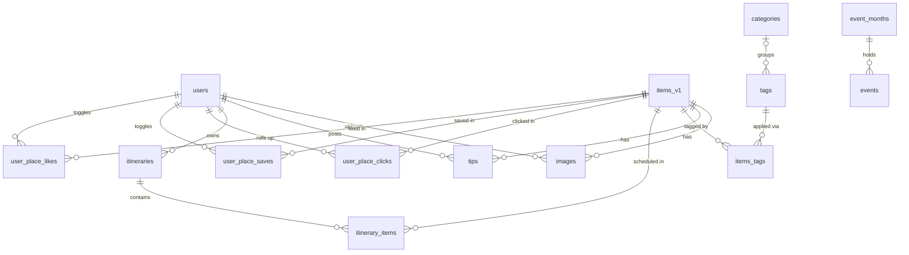
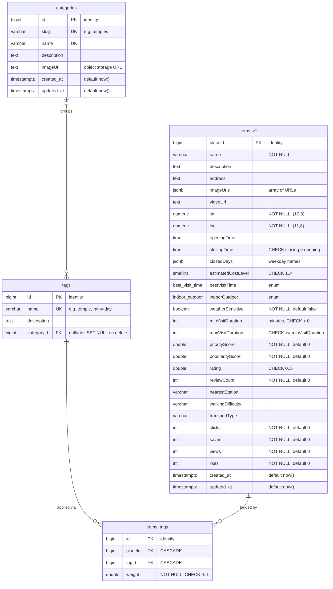
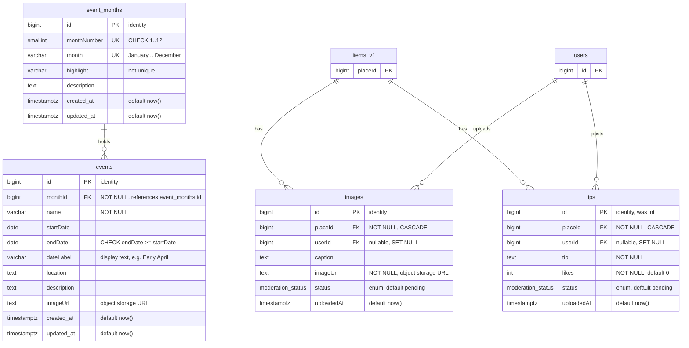
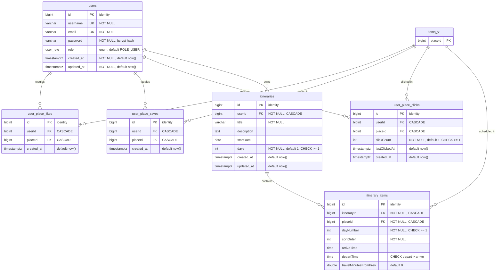

Kyoto Visual Voyage · PostgreSQL schema

# Entity-relationship diagram

## About Kyoto Visual Voyage

Kyoto Visual Voyage is a sightseeing app for Kyoto. Visitors browse places such as temples, gardens and street-food areas, with photos, opening hours, costs and access notes. They can follow a seasonal events calendar, share photos and tips, and save or like places they want to visit.

The backend is a FastAPI service on PostgreSQL. It also builds day-by-day itineraries and ranks places for each traveller using their likes, saves and clicks. This page documents the database behind it. It is the MP-4 project at KCGI, Spring 2026.

**14**tables

**3**domains

**4**enum types

**1**hub table: items_v1

## Overview

Every table and every relationship, without columns. `items_v1` is the hub: all three domains reference it.

## 1 · Places and taxonomy

A place carries several weighted tags. Tags roll up into categories through an optional foreign key.

`PK` primary key `FK` foreign key `UK` unique Quoted text after a column holds its default, check or delete rule.

## 2 · Community content and events

Photos and tips point at a place and a user. Events join to their month by integer key and carry a date range.

## 3 · Users, engagement and itineraries

Likes, saves and clicks are per-user join tables with a unique pair. Itinerary stops cannot collide on the same slot.

Composite unique keys: `UNIQUE(userId, placeId)` on likes, saves and clicks · `UNIQUE(placeId, tagId)` on items_tags · `UNIQUE(itineraryId, dayNumber, sortOrder)` on itinerary_items

## Enums and extra indexes

| Type | Values | Used by |
| --- | --- | --- |
| `best_visit_time` | morning, afternoon, evening, night, anytime | items_v1.bestVisitTime |
| `indoor_outdoor` | indoor, outdoor, mixed | items_v1.indoorOutdoor |
| `moderation_status` | pending, approved, rejected | images.status, tips.status |
| `user_role` | ROLE_USER, ROLE_ADMIN | users.role |

| Index | Purpose |
| --- | --- |
| `items_tags(placeId)`, `items_tags(tagId)` | Tag lookups in both directions for the recommender and planner |
| `images(placeId, status)`, `tips(placeId, status)` | Approved content per place, moderation queue |
| `user_place_*(userId)`, `user_place_*(placeId)` | Profile lists and counter recomputation |
| `itineraries(userId)`, `itinerary_items(itineraryId)` | Listing a user's trips and loading one plan |
| `events(monthId)` | Calendar by month |

## Table dictionary

What each table stores and which feature depends on it.

| Table | Stores | Used by |
| --- | --- | --- |
| `categories` | Top-level groupings of places, such as temples or food, with a slug and image. | Category browsing |
| `tags` | Fine-grained labels such as temple, rainy-day or couples, each optionally under a category. | Place filtering, recommender, planner |
| `items_tags` | Which tags a place has, with a 0 to 1 weight for how strongly the tag applies. | Category pages, recommender, planner |
| `items_v1` | One row per place: location, hours, cost, visit length, scores, access notes and engagement counters. | Almost every feature |
| `images` | Photos submitted by users, with a moderation status. | Place galleries, moderation queue |
| `tips` | Short tips submitted by users, with likes and a moderation status. | Place pages, moderation queue |
| `event_months` | The twelve months of the seasonal calendar, with a highlight and description. | Events calendar |
| `events` | Festivals and seasonal events within a month, with dates and location. | Events calendar |
| `users` | Accounts: username, email, password hash and role. | Sign-in, ownership of everything below |
| `user_place_likes` | One row per user and place the user liked. | Like button, profile, recommender |
| `user_place_saves` | One row per user and place the user saved. | Save button, profile, recommender |
| `user_place_clicks` | Click history rolled up to one row per user and place, with a count and last-clicked time. | Profile, recommender |
| `itineraries` | A saved trip: title, start date, number of days, owner. | Itinerary planner |
| `itinerary_items` | The stops in a trip: place, day, order, and stored arrive and depart times. | Itinerary planner, route optimizer |

## Delete behaviour

What happens to related rows when a parent row is removed.

| Deleting a row in | Related rows | Rule |
| --- | --- | --- |
| `users` | user_place_likes, user_place_saves, user_place_clicks, itineraries | Cascade |
| `users` | images.userId, tips.userId | Set null The photo or tip stays, without an author. |
| `items_v1` | items_tags, likes, saves, clicks, itinerary_items, images, tips | Cascade |
| `tags` | items_tags | Cascade |
| `categories` | tags.categoryId | Set null The tags stay, uncategorised. |
| `itineraries` | itinerary_items | Cascade |
| `event_months` | events | Cascade A month and its events are removed together. |

## Design decisions

### items_v1 is the hub

Every user-facing feature points at a place, so all engagement, content and itinerary tables reference `items_v1.placeId`. A place is one row; everything about it hangs off that key.

### Weighted tags instead of one category

A place such as Fushimi Inari is both a temple and a nature walk. `items_tags` stores each tag with a weight, so ranking and filtering can tell a strong match from a weak one. Categories sit above tags for navigation.

### Toggles and rollups

Likes and saves are on or off, so a unique pair of user and place makes a double tap harmless. A click can repeat, so clicks keep one row per pair with a counter.

### Counters kept on the place

Likes, saves, clicks and views are stored on `items_v1` so ranking can read them without counting join tables. Views are anonymous and have no per-user table.

### Stored itinerary times

Arrive and depart times are saved on each stop. A plan the traveller edited by hand keeps its schedule instead of being recomputed on every read.

### Enums, checks and URLs

Moderation status, role and visit time are enums, and ranges are CHECK constraints, so bad values are rejected by the database. Images are stored as URLs, not base64, to keep rows small.